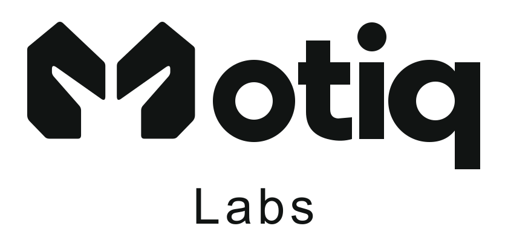

<picture>
  <source media="(prefers-color-scheme: dark)" srcset="assets/brand/motiq-reversed.svg">
  
</picture>

# Motiq Labs website

Website and canonical brand assets for [Motiq Labs](https://www.motiq.hr), an engineering team in Zagreb working on robotics, computer vision, automation software and infrastructure.

English: `index.html`. Croatian: `hr.html`. GitHub Pages publishes the root of `master` to **www.motiq.hr**. The same generated pages are also used in the connected Sites preview. Keep both destinations in sync; edit this repository rather than creating a separate copy of the site.

## Edit and build

Edit `src/site.html`, `locales/en.json`, `locales/hr.json`, `css/tokens.css` and `css/style.css`. Run `npm run build` to validate translation keys and regenerate both entry pages and their content-hashed assets. Commit the source and generated output together. Historical hashed assets are retained for cached pages.

For a local preview, run `python3 -m http.server 8766 --bind 127.0.0.1`. Check both languages, light/dark themes, keyboard navigation and narrow screens.

The robot scenes are illustrative, with motion off by default and an explicit play/pause control. Reduced-motion preferences are respected. Project descriptions distinguish prototypes and research from completed deployments. The document assistant is an illustrative example. The contact form prepares an email in the visitor's app; the visitor reviews and sends it.

## Brand assets

`assets/brand/master.json` contains the approved M + gripper geometry and the outlined, centered **Labs** subtitle approved on 15 October 2026. No font installation is required to render the logo. See [the brand guide](assets/brand/README.md).

Run `npm ci` and `npm run brand:build` to regenerate SVG, PNG, icons and the social preview. `BRAND_NODE_MODULES` can select an existing Node module directory containing Sharp. Commit the master, generator and exports together. Small square icons use the M symbol without the subtitle.

Obsolete standalone design drafts are not included in the current public tree.

## Planned AI agent

The AI agent section is a product announcement, marked “In preparation” / “U pripremi”. The listed capabilities are a planned focus, not a claim of an available product. No launch date, trial access or membership of a startup program is claimed. The separate document-assistant example remains illustrative. Update these states when the prototype has been validated.

The compact portfolio lists UNIJA NOVA and Apartmani Dubravko, as supplied by the owner. The apartment logo is the supplied Logo2024 image. No project outcomes or endorsements are asserted.

The UNIJA NOVA portfolio uses official color and white logo variants from unija-nova.hr (retrieved 15 October 2026), with proportions preserved and local files used for reliable loading.

## AI-BOOST attribution

The EU funding acknowledgement is scoped to the AI-BOOST programme (Horizon Europe, GA 101135737), not a statement that Motiq has received payment. Official PNG funding statements are unmodified files from the European Commission download centre: https://ec.europa.eu/regional_policy/information-sources/logo-download-center_en. Programme facts: https://cordis.europa.eu/project/id/101135737. Communication statement: 2026 AI-BOOST applicant guidelines, section 6.3 (PDF page 35).
